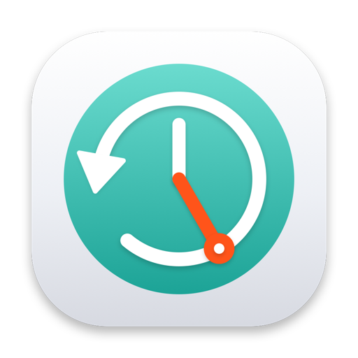
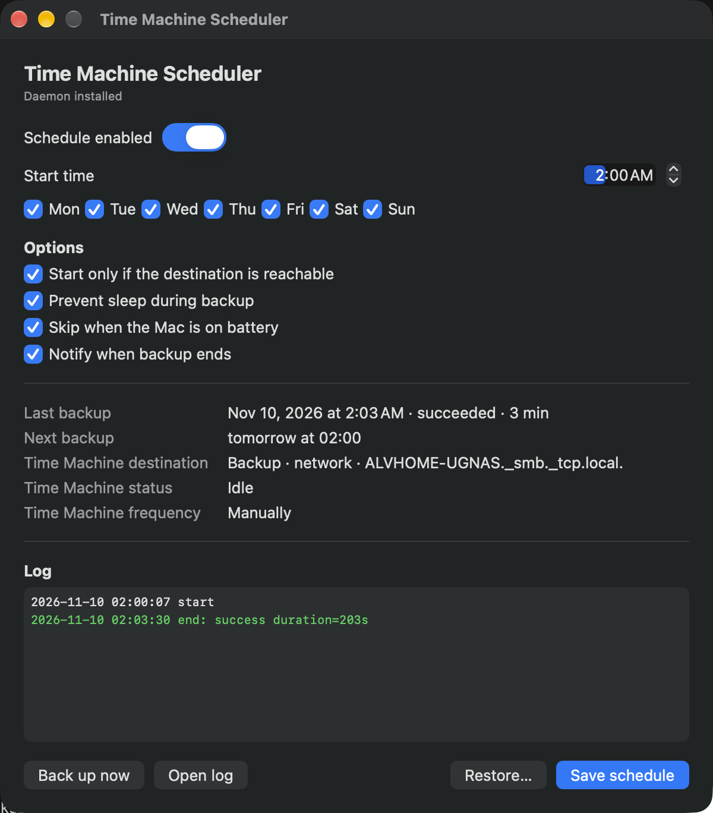

<div align="center">



# Time Machine Scheduler

**Backups on your schedule.**

A macOS app to run Time Machine backups on specific days and times, instead of
relying on the interval anchored to the last completed backup.

[](https://github.com/alv67/time-machine-scheduler/releases/latest)
[](https://github.com/alv67/time-machine-scheduler/releases)
[](LICENSE)

[](https://www.apple.com/macos/)
[](https://support.apple.com/en-us/102861)
[](https://developer.apple.com/xcode/swiftui/)

[**Download**](https://github.com/alv67/time-machine-scheduler/releases/latest) · [**Releases**](https://github.com/alv67/time-machine-scheduler/releases) · [**Issues**](https://github.com/alv67/time-machine-scheduler/issues) · [**Buy me a coffee**](https://buymeacoffee.com/alv67)

</div>

Time Machine decides when to back up based on the last completed backup. Time
Machine Scheduler adds a real schedule: hour, minute and weekdays. Built with
macOS 14+, SwiftUI, no external dependencies, non-sandboxed app, `launchd` daemon
installed with `osascript` and admin privileges (approach A).

<p align="center">
  
  <br>
  <sub><i>Schedule, options, last and next backup, and a readable log in one window.</i></sub>
</p>

## Features

- **Time and days** — pick the exact time and weekdays; the backup runs when you decide.
- **Your destination** — reads the destination configured in Time Machine, local or network, and checks that it is reachable.
- **No surprises** — skips on battery, prevents sleep during the backup and notifies you when it ends.
- **Status and logs** — phase, percentage, last backup and a readable log with automatic rotation.
- **Back up now** — start a backup outside the schedule without waiting for the next run.
- **Clean restore** — removes daemon, script and logs and puts Time Machine back on the frequency you choose.
- **Italian and English** — UI, help and About panel follow the system language.

## Requirements

- macOS 14 or later
- Apple Silicon Mac (arm64 build)
- A configured Time Machine destination
- Administrator password to install the daemon
- Command Line Tools to build (`xcode-select --install`); no Xcode project required

## Install

1. Download the DMG and open it.
2. Drag **TimeMachineScheduler.app** into Applications.
3. Open the app and click **Save schedule**: it installs the daemon and asks for the administrator password.

### Gatekeeper

The app is ad-hoc signed, not with a Developer ID, and not notarized. On recent
macOS, double-clicking the DMG may show "Installation failed" because automatic
installation requires a verifiable signature.

If macOS blocks the app, use **System Settings → Privacy & Security → Open
Anyway**, or remove the quarantine flag:

```bash
xattr -dr com.apple.quarantine /Applications/TimeMachineScheduler.app
```

Local install without Gatekeeper:

```bash
make install
# or into a user folder:
make install PREFIX=~/Applications
```

## Usage

1. Set time, days and options.
2. **Save schedule**: asks for the admin password and installs/updates the daemon.
3. If the banner reports an automatic Time Machine frequency, use **Open Time
   Machine Settings** and choose "Manually" to avoid duplicate backups.
4. **Back up now** starts a backup outside the schedule.
5. **Restore…** removes daemon, script and logs and puts Time Machine back on the
   frequency you choose (Manually, hourly, daily, weekly).

The destination is not entered by hand: it is read from Time Machine
(`tmutil destinationinfo`) and works with any destination, local or network. With
reachability checks enabled, the daemon pings the network destination host (including
Bonjour names such as `*.local`) before starting the backup.

## Build from source

```bash
make test     # checks scheduling logic and plist generation
make app      # builds build/TimeMachineScheduler.app
make run      # opens the app
make dmg      # builds build/TimeMachineScheduler-0.1.0.dmg
make release  # builds DMG, ZIP and SHA256SUMS.txt
make install  # copies to /Applications and removes the quarantine flag
```

The default build is **arm64**. For a universal binary (Intel on macOS 14–26, not
tested on Intel hardware):

```bash
make release ARCHS="arm64 x86_64"
```

To sign with a Developer ID:

```bash
make release SIGN_ID="Developer ID Application: Name (TEAMID)"
```

If the Dock still shows the old icon after changing it, macOS is using the
LaunchServices cache:

```bash
make refresh-icon
```

## Stack

| Layer | Technology |
|-------|------------|
| App | SwiftUI, macOS 14+, arm64 |
| Daemon | `launchd` + shell script, installed by `osascript` with admin privileges |
| Build | `swiftc` + `Makefile`, no Xcode project |
| Tests | Swift, scheduling logic and plist generation |
| Distribution | DMG, ZIP, `SHA256SUMS.txt`, GitHub Actions |

## Project layout

```
App/        SwiftUI UI, model, tmutil controller, installer
Daemon/     script run by the LaunchDaemon
Resources/  icon, it/en localizations and DMG readme
docs/       project website (IT/EN) for GitHub Pages
Tools/      icon generator (Core Graphics)
Tests/      tests for pure logic (schedule + plist)
.github/    release, Pages and triage workflows
Info.plist  bundle metadata
Makefile    build, test, run, dmg, release
```

The icon is generated by `Tools/make-icon.swift` (no external binary to download);
`make icon` regenerates it. The app menu includes **About Time Machine Scheduler**
(version, copyright © 2026 Alessandro Varesi and project link). The **Help** menu
opens a local guide in a dedicated window; the GitHub page is reachable from both
Help and About.

## Known limitations

- Mac powered off: no schedule can wake it (Apple Silicon does not support
  `poweron`). The backup runs on the next boot.
- arm64 only: Intel Macs are not supported in this release.
- Mac asleep with the lid closed: `caffeinate` does not prevent that kind of sleep;
  the job may start late or be unreliable.
- The UI only needs to be open to use it: the daemon works on its own.
- Menu bar icon/menu not included.
- `tmutil listbackups` is not used: no Full Disk Access permission required.

## Release

`make release` produces the DMG (app, Applications link and IT/EN `Leggimi.txt`),
the ZIP and `SHA256SUMS.txt`. A public release is created with a tag:

```bash
git tag v0.1.0
git push origin v0.1.0
```

The `.github/workflows/release.yml` workflow runs the tests, builds the artifacts
and publishes the GitHub release. The tag must match `CFBundleShortVersionString`
in `Info.plist`.

Without notarization the release stays "unverified" by Gatekeeper: the DMG
includes instructions, but users must approve the app. A Homebrew tap can be added
later, pointing at the release DMG.

<details>
<summary><b>Release flow and website</b></summary>

Flow: development on `develop`, preparation on `release/0.1.0`, pull request to
`main` when the release is ready, merge to `main` → GitHub Pages deployment, tag
`v0.1.0` → GitHub release.

The project page lives in `docs/` (Italian in `docs/index.html`, English in
`docs/en/index.html`) and is published by `.github/workflows/pages.yml` when `main`
is updated.

- Expected URL: https://alv67.github.io/time-machine-scheduler/
- GitHub Pages on a private repository requires GitHub Pro/Team/Enterprise. On
  GitHub Free the repository must be public.

</details>

<details>
<summary><b>System paths touched</b></summary>

- `/Library/Application Support/TMScheduler/config.json`
- `/Library/Application Support/TMScheduler/last-run.json`
- `/Library/Application Support/TMScheduler/tmscheduler.log` (+ `.1`, `.2`, `.3`)
- `/Library/LaunchDaemons/local.tmscheduler.nightly.plist`
- `/usr/local/bin/tmscheduler-run`
- Time Machine `AutoBackup` / `AutoBackupInterval` preferences (only through
  "Open Time Machine Settings" and "Restore…")

</details>

<details>
<summary><b>Manual tests</b></summary>

- [ ] After **Save schedule**, `launchctl print system/local.tmscheduler.nightly`
      shows the job.
- [ ] `sudo launchctl kickstart -k system/local.tmscheduler.nightly` starts the
      backup and the log records start/end.
- [ ] With the Time Machine destination off or unreachable, the daemon writes
      `skip: destination … unreachable` and does not start Time Machine.
- [ ] With a backup already running, the daemon writes `skip: backup already running`.
- [ ] Changing time/days in the app regenerates the plist and reloads the job.
- [ ] With the toggle OFF, the job does not run.
- [ ] **Restore…** removes plist and script and restores
      `AutoBackup`/`AutoBackupInterval` to the selected values.
- [ ] Mac asleep with the lid open at 02:00: behavior consistent with the limits
      above.
- [ ] After use, `tmutil listbackups` and manual backups from the system UI work.

</details>

## Support

If the app is useful to you, you can [buy me a coffee](https://buymeacoffee.com/alv67).
The project stays free and open source for everyone.

## License

MIT — see [LICENSE](LICENSE). © 2026 Alessandro Varesi.
